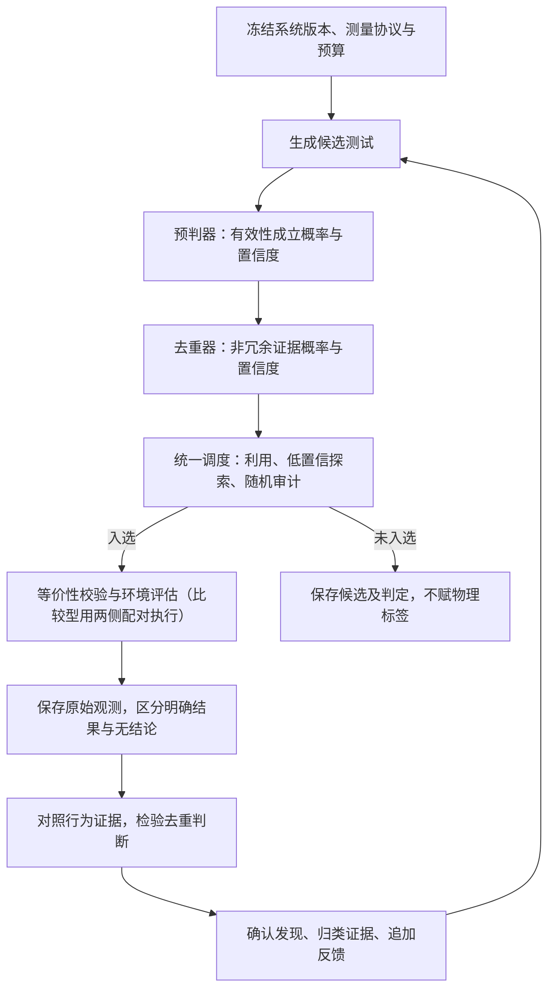

# SiGen：用真实实验改进实验系统

SiGen 是一个自进化实验 harness。它面对的问题是：Generator 产出实验对象，环境反馈判定这些对象是否成立；系统用这份反馈同时改进生成、预判与去重，并审核自己的更新。

被评估的对象始终是 Generator 的产物，不是“配对”本身。配对执行只是比较类任务里最常用的一种评估形式：当问题被表述为“目标 A 相对对照 B 的稳定差距”时，两侧同语义执行是取得该证据的手段；换成别的任务，证据形式会变，判定“产物是否有效”这一点不变。文件系统对比是一个例子：同一语义的负载在 XXFS 与 GPFS 上运行，确认差距及成立条件。这里使用这两个名字说明问题，不假设 XXFS 的实现细节，也不宣称已有实验结果。

候选代码可以大量生成，可信结果却需要准备数据、控制环境、运行对照和重复测量。SiGen 要验证的是：在相同成本下，能否发现更多**非重复、可复现、有现实意义的有效发现**；比较型任务里即相对短板，并使生成、预判、去重和更新审核持续改善。本仓库是一份设计规范，尚不是可部署的测试平台。

## 为什么生成后筛选还不够

朴素流程是生成测试、两侧运行、筛出差距、反馈给生成器。它有可信的裁决来源，但大量预算可能花在没有差距的测试上，或者反复确认同一个已知问题。

预判器可以改变这种分配，也会引入选择偏差：预判为假的测试不再执行，预判器就失去了发现假阴性的机会。生成器若随后只生产预判器偏爱的负载，搜索范围会逐渐缩小。去重器和审核器有同样的问题：被误合并的测试、被误拒绝的更新如果永不尝试，错误便不会进入经验。

SiGen 把判断与动作分开。模型报告自己的判断和经验可靠性；调度在预算内选择实际试验；结果再检验判断。被否决的对象仍保留执行机会，重复样本不重复计算发现数量。随机探索降低封闭风险，但有限预算不能保证所有错误都被发现，更不能保证更新绝不退化。

## 一轮实验如何完成

1. **限定实验对象。** A、B 的版本、硬件、配置、负载语义、主指标、实际意义阈值与重复测量协议必须明确。预测和真值绑定这些条件，版本变化不会自动继承旧标签。
2. **生成候选。** 每个候选包含代码、参数、初始状态、操作与并发关系、正确性不变量及生成假设。生成器可以感知预判器、去重器的版本化逻辑和历史经验，但模型分数不能替代真实发现收益。
3. **预测并去重。** 两个组件为整批候选留下判定记录。去重参照既有代表和同批候选；表面改写应合并，关键状态变化的受控变体应保留比较关系。预测为假的候选不在去重前永久丢弃。
4. **分配执行预算。** 高预测收益用于利用；低置信对象用于学习经验边界；随机审计覆盖高置信否决，并能越过两个模型的软否决。预算不足是延后原因，不是负标签。
5. **获得环境反馈。** 对入选候选校验两侧工作等价性，交错执行并重复测量。实测噪声决定结论，预判器预测的方差不能决定实验是否显著。编译失败、超时原因不明、测量不稳定须单独记录。
6. **按问题回流。** 有效测量可给预判器标签；去重器还需要候选与代表的行为对照；根因归类需要额外定位证据。所有运行记录都保存，但不会把所有记录都当成所有组件的训练标签。

流程保留预判器后去重的顺序，同时避免两级硬过滤。廉价的字节级精确去重可以节省判定成本，但代码相同而参数、并发、初始状态不同的实验不属于完全重复。

## 两个数分别说明什么

统一判断核心是 `Verdict = { value: float, confidence: float }`。

- `value` 在 0—1 之间，表示**明确定义的命题成立的预测概率**。统一极性：越大越支持试验。不把期望收益、差距幅度和概率混用。
- `confidence` 在 0—1 之间，表示**对这类概率估计可靠性的经验支持程度**。它不等于 `value`，也不等于运行噪声。实现必须用留出的有效历史证据检验它；没有证据时按低置信处理。

预判器判断“指定协议下，环境反馈是否会确认该产物有效”，比较类任务中即“是否存在超过阈值的稳定差距”；去重器判断“相对指定代表，候选是否提供已有证据不能替代的实验信息”；critic 判断“更新是否在指定对照窗口中满足收益及能力保留条件”。命题、模型版本、经验来源和选择概率放在判定档案中，不挤进两个数。

统一接口不意味着把预判值与去重值相乘，也不意味着共用一个阈值。两种判断可能相关，动作成本也不同。调度须记录自己的策略及**最终入选概率**；仅记探索率不足以纠正经过多级筛选的选择偏差。

## 系统如何修改自己

生成器、预判器、去重器和 critic 都可以提出代码、提示、规则或经验组织方式的更新。自进化指这些可检查的工件被修改并经实验证实；不预设一定要训练模型权重，也不预设必须拆成四个独立 Agent。

更新走另一条流程：保存基础版本与完整差异 → 由旧版本 critic 判断 → 调度决定延后或有限试行 → 对候选版本与基础版本进行预算匹配的观察 → 分配信用 → 晋升、恢复基础版本或保留待决状态 → 追加经验。

**试行与晋升是不同动作。** 低置信拒绝允许探索性试行，避免 critic 只从误放中学习；试行完成不自动晋升。critic 修改自身时，原始判定仍由明确的旧版本作出。新版本不能重写旧判定，也不能改变该轮成功标准。组件可以在同一仓库中被感知和修改，原始证据、评估协议和版本切换记录保持可追溯。

观察窗口须有实际的基础版本对照。前后发现率上升可能来自负载、环境或剩余问题难度变化，不能直接归因于更新。证据不足时返回“尚不能归因”，而非强填好更新或坏更新。

## 如何判断值得继续

主结果报告**独立、可复现且具有定位证据的短板发现率**，同时报告总机器时间、模型调用和人工诊断成本。尚未确定根因的行为簇与已证实根因分开计数；去重器不能凭自己的聚类宣布独立根因增加。

对照逐层检验预判调度、语义去重、生成器更新、判定组件更新及 critic 自我更新的增量贡献。相同机器预算的实验仍可能有不同总成本，两种口径须同时报告。旧能力保留、探索覆盖、置信度校准和误拒绝审计是约束，不替代发现收益。结果允许判负：组件没有稳定增益，就不应仅因它能自我修改而保留它。

## 设计依据

规范依据是 [design-by-viba](https://github.com/lixinqi/design-by-viba)：需求先行、外部只依赖 public、概念关系落在类型和函数参数中，从根入口检查可达性与依赖环。语言语法和定义规范以 [viba](https://github.com/lixinqi/viba) 及其 [定义规范](https://github.com/lixinqi/viba/blob/main/viba/core/viba-style.md) 为准。`.viba.md` 给出类型与操作意图，具体逻辑仍由实现者提供；语法可加载不等于系统收益已经得到证明。

完整接口见 [根设计规范](README.viba.md)。[动机与取舍](docs/motivation.md) 解释适用条件和替代方案，[评估方案](docs/evaluation.md) 给出可复核的试验与判负条件，[知识库文章](docs/knowledge-base.md) 用图解展开证据流、探索与更新归因。
