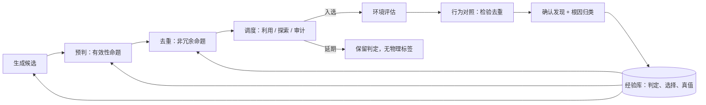
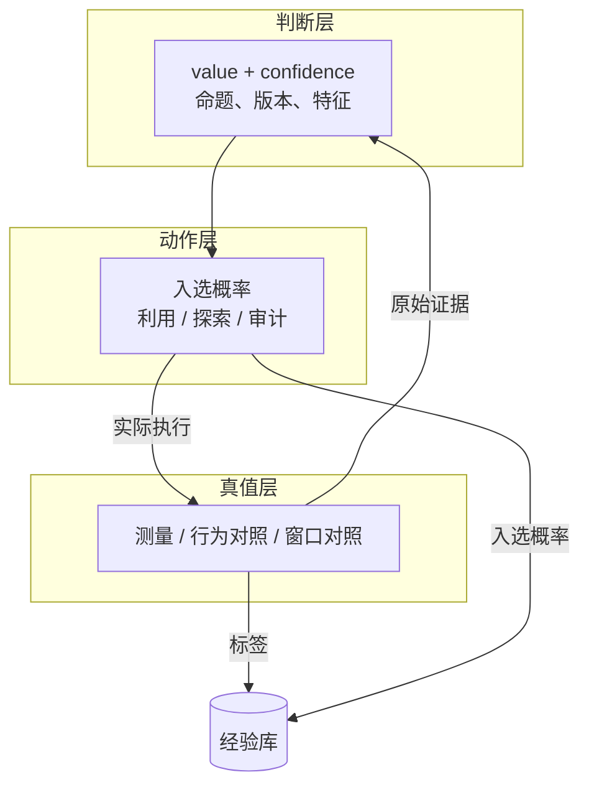
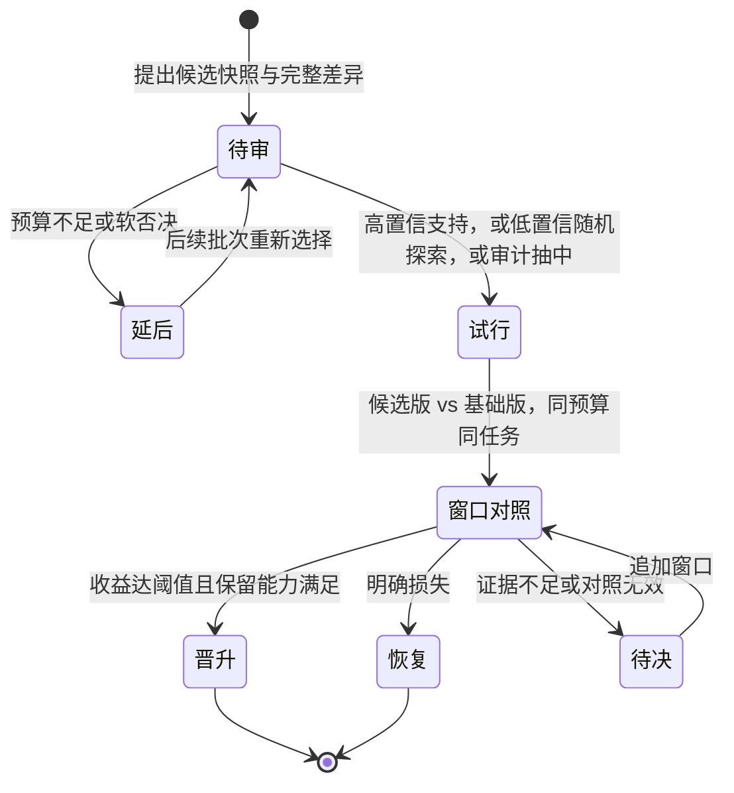
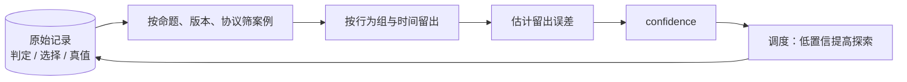

# SiGen 知识库：一个用真实实验改进自身的实验系统

这篇文档面向第一次接触这套设计的读者，用图解释它到底在做什么、每一层为什么存在、哪些直觉是错的。完整接口见根设计规范，取舍理由见动机文档。

## 一句话概括

系统在昂贵的环境反馈上做搜索：Generator 产出实验对象，环境反馈判定它是否有效，每次运行的结果用来改进“生成什么、预判什么、信谁”。被评估的对象是产物，不是“配对”本身；配对执行只是比较类任务的一种实现形式。

它不追求“让模型写出更多测试”，只关心一件事：**在相同成本下，是否发现了更多非重复、可复现、说得清原因的问题。**

## 三个判断，三种命题

系统里有三个组件会给出判断，它们共用同一种输出结构，但回答的问题完全不同。

| 组件 | 判定的命题 | 真值来自 | 典型错误 |
| --- | --- | --- | --- |
| 预判器 | 该生成结果在指定协议下是否会被环境反馈确认有效 | 环境评估（比较类任务用两侧配对执行） | 判为不会成立却成立（漏报），判为成立却只是噪声 |
| 去重器 | 相对指定代表，该候选是否提供不能替代的实验信息 | 候选与代表的行为对照 | 误合并（丢掉有价值的变体）、误拆分（纵容换皮） |
| 审核器 | 该更新是否满足收益与能力保留条件 | 候选版与基础版的窗口对照 | 误放（放过坏更新）、误拒绝（拒掉好更新） |

三者共享的两个数是：

- `value`：命题成立的预测概率，方向统一为“越大越支持试验”；
- 预判器不是物理预言机，它拟合的是环境反馈：给定产物与条件，预测环境会给什么反馈，并说明哪些区域还不可靠；
- `confidence`：这类估计有多少可靠经验支撑，由留出历史校准，不由模型自报。

## 图一：一条证据流走完全程

四个要点：

1. 预判在去重之前，因为推断比语义比较便宜；但两者都不做硬过滤，最终执行由调度在一个总预算里决定。
2. 延期不是负标签。它表示“这次没花钱”，不表示“这个对象没有价值”。
3. 每条记录同时保存判定、选择路径和真值；后续校准用的是当时的原始判定，不是事后重算的分数。
4. 经验回流分三种，不能互相替代：测量的结论喂预判器，行为对照的结论喂去重器，窗口对照的结论喂审核器。

## 图二：判断、动作、真值三层分离

这一层分离解决的问题，是自进化系统最常见的失效方式：**判断者同时决定自己看到什么**。

如果预判器判“不会有差距”的候选直接不跑，预判器就永远没有机会知道自己错了。系统会进入一个自洽的循环：预判器支持什么，生成器就多生产什么，预判器在被筛过的分布上越来越准，覆盖越来越窄，而所有指标都在变好。

三层分离并不意味着判断不重要。它意味着判断只影响“花多少钱去验证”，不单独决定“是否撤销验证机会”。审计样本从原始合格候选中抽取，能越过两个模型的否决，这是唯一能估计漏报的入口。

## 图三：去重要分三层看

三层的成本与结论都不同。

- **代码层**只用于完全相同的对象，可以省下判断成本；代码相似但参数、并发、初始状态不同的实验不算重复。
- **行为层**是运行前的语义判断，也是去重器的主战场。它输出三类关系：冗余重复、受控变体、语义新样本。
- **根因层**发生在运行之后，需要定位证据。

箭头方向很重要：同一根因可以由多个行为不同的测试命中，因此“根因相同”不能证明“运行前两个测试冗余”。反过来，一个测试逻辑在不同状态、不同版本下也可能暴露不同问题。把根因归类当成运行前去重标签，会让系统丢掉能独立定位同一机制的入口。

去重器的标签也因此必须来自额外的行为对照，而不是候选自己“有短板”这个事实。候选一侧阳性只说明值得关注，不说明它相对某个代表提供了新信息。

## 图四：更新的生命周期

四个容易混淆的点：

**试行不等于晋升。** 试行只是获得一次观察机会。审核器经验不足时允许探索性试行，目的是让“被拒掉的好更新”也有机会留下证据；试行结束并不自动变成新基础版本。

**延后不等于拒绝。** 预算不足、资源不可用、证据未到，都停在待审，等着被重新选择。把它记成负结果，会让审核器只学会保守。

**原始判定由旧版本作出。** 审核器修改自身时，本次更新的判断仍由修改前的版本给出。新版本只影响之后的判断。否则一次更新可以先用新逻辑重写旧结论，再用重写的结论证明自己正确。

**观察要有基础版本对照。** 前一窗口与后一窗口的发现率不能直接比：任务难度、环境状态、被测系统版本都在变。只有在同一窗口、同一任务、同预算下与基础版本对照，差值才有归因意义。证据不足时输出“尚不能归因”，这是正常结果，不是失败。

## 图五：置信度从哪来

置信度的三个约束：

- 它衡量的是“这类判断可靠不可靠”，不是“这次判断对不对”。充分经验支持的低概率预测也可以高置信。
- 校准只用有效且结论明确的历史。无结论、无效执行、延期都不进入案例集。
- 每个案例必须带当时的入选概率。只记录“跑过的对象”，等于只保留被三重筛选过的样本，用它算出的准确率不代表模型在全体候选上的表现。

## 十个常见误解

| 误解 | 为什么不对 |
| --- | --- |
| 预判器越准越好，所以只跑它认为有差距的样本 | 在收缩后的分布上准确率可以任意高，覆盖和漏报才是要报告的 |
| 三种判断可以用一个加权分数合成 | 命题、标签来源、成本都不同；合成后既不能归因，也不能正确校准 |
| 审核器输出布尔值，事后抽样复审即可 | 复审的触发、预算和回流没有进入接口，实际运行时最先被砍掉 |
| 只要不退化就说明更新成功 | 永不更新也能满足；必须同时衡量收益与过度保守 |
| 更新前后指标上升即证明更新有效 | 任务难度、环境与多个改动同时变化，缺少对照就没有归因 |
| 去重器判定重复就等于删掉 | 冗余是相对某个代表集合的判断，需要保留审计与边界对照 |
| 同一根因出现两次，说明两个测试重复 | 根因相同可以由不同行为暴露，运行前冗余需要行为证据 |
| 运行失败可以当负样本 | 编译失败、环境失效、无法归因的超时会教出“系统没短板” |
| 预判器预测的方差可以用来定显著性门槛 | 显著性必须由实测噪声与冻结协议决定，否则模型自信度会影响结论 |
| 自进化就是把组件都改成模型权重 | 自进化针对的是可检查的工件：代码、提示、规则、经验组织方式 |

## 结果怎么看

主指标只有一条：每单位真实实验成本，环境评估确认的独立、可复现、有定位证据、具现实代表性的有效发现数；比较型任务即短板根因数。

配套必须报告：未确认行为簇数、三类成本、执行覆盖、审计样本量与估计漏报、审核器拒绝率、误拒绝后被证明有价值的比例、置信度校准误差。

判断“要不要继续做”的方式不是看某一个数字漂亮，而是看逐层对照：预判调度、语义去重、生成器更新、审核器更新，每一层是否在没有缩小覆盖的前提下提高了主指标。任何一层不成立，就应该把它降级为分析工具或直接去掉。

## 读下去的顺序

- 想知道整体流程与两个数字的含义：仓库 README。
- 想知道每个类型为什么这样定义：根设计规范与各组件设计文档。
- 想知道为什么否掉某些简化：动机与取舍。
- 想知道如何做对照与判负：评估方案。
